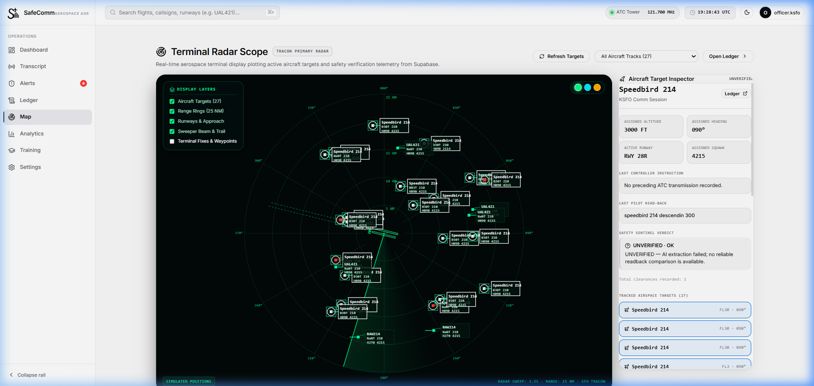
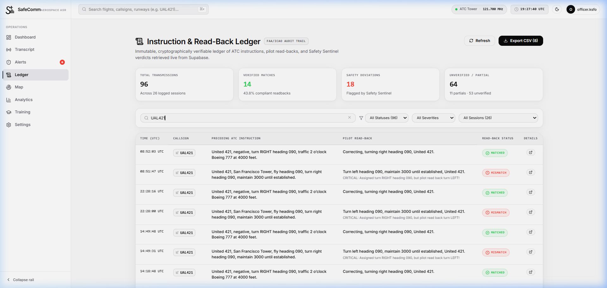
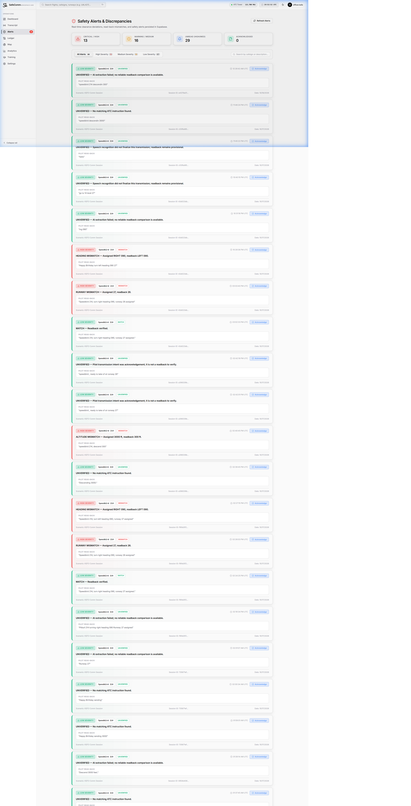
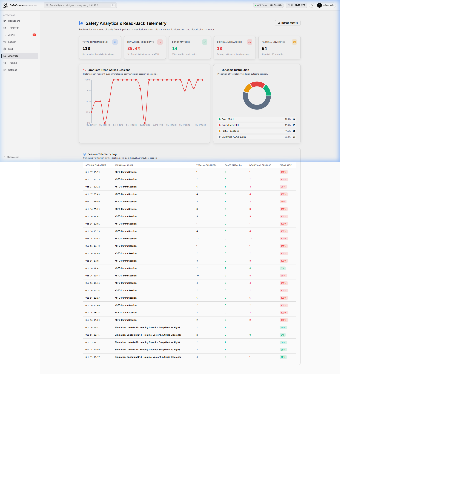

# SafeComm — AI-Powered Aeronautical Radio Read-Back Safety Platform

> **SafeComm is an intelligent aeronautical safety platform that continuously monitors air traffic radio exchanges, automatically detecting clearance deviations and read-back errors before they become runway incursions or airspace conflicts.**
>
> Built for air traffic controllers, flight crews, and aviation safety officers, SafeComm combines real-time speech processing, AI instruction extraction, and deterministic phraseology rulebook verification with real live ADS-B surveillance.

---

## Prototype Notice

> **PROTOTYPE — NOT FOR OPERATIONAL USE**
> SafeComm is an aeronautical safety demonstration and training prototype designed for evaluation, safety research, and phraseology training. It is not certified for operational air traffic control separation or flight operations.

---

## Screenshots

The following interface screenshots represent the implemented application:

| Live Radar Scope & Target Inspector | Real-Time Safety Audit Ledger |
| :---: | :---: |
|  |  |
| *10 NM terminal scope with real ADS-B traffic & Planespotters photo enrichment* | *Electronic flight strips with side-by-side readback evaluation and CSV export* |

| Safety Alerts & Severity Dispatch | Historical Safety Analytics & Trends |
| :---: | :---: |
|  |  |
| *Severity-graded alerts with Web Audio Master Caution earcons* | *Real-time error rate tracking and outcome distribution donuts* |

---

## Technology Stack

- **Frontend Core**: React 19, TypeScript, Vite, React Router 7.
- **Styling & Design System**: Bespoke Aerospace Design System with pure black-and-white Day Light Mode, low-glare Night Dark Mode, and CSS custom property design tokens.
- **Backend & Cloud**: Supabase (PostgreSQL with Row Level Security, Supabase Auth, Supabase Realtime WebSocket subscriptions, Deno Edge Functions).
- **Surveillance & Telemetry**:
  - Open ADS-B surveillance integration via [adsb.fi](https://adsb.fi/).
  - Authentic aircraft photograph enrichment via [Planespotters.net API](https://www.planespotters.net/).
- **Voice & Acoustic Synthesis**:
  - Web Audio API procedural synthesis for aviation Master Caution two-tone earcons.
  - Web Speech API (`SpeechSynthesis`) for authentic ATC controller, pilot read-back, and advisory audio.
  - Agora RTC SDK for low-latency bidirectional WebRTC voice communication rooms.
- **AI & Natural Language Processing**:
  - Dual-parser architecture: Cloud LLM extraction (Groq Llama 3.3 70B & Google Gemini 2.5 Flash) via isolated Supabase Edge Functions.
  - Sub-5ms deterministic regex/phraseology local fallback extractor.
  - Deterministic Aeronautical Verification Engine based on **FAA Order 7110.65** and **ICAO Annex 10**.
- **Data Visualization**: Recharts (responsive line charts, distribution donuts, custom aerospace tooltips) and HTML5 Canvas (high-contrast CRT phosphor radar scope).
- **Quality Assurance**: Vitest (227 automated tests), Oxlint, TypeScript strict mode.

---

## Core Features

1. **Terminal Radar Scope (`/map`)**
   - High-contrast CRT phosphor radar scope defaulting to **10 NM** terminal airspace (with 10, 25, 40, and 60 NM range rings).
   - Real-time ADS-B aircraft telemetry from `adsb.fi`, plotting genuine traffic, heading vectors, and SFO runway alignments.
   - Dynamic label decluttering and 4-quadrant collision avoidance capping visible labels at 6–8 prioritized targets.
   - Comprehensive **Aircraft Target Inspector** displaying:
     - Header with callsign, flight status (`LIVE ADS-B` or `ON GROUND`), and aircraft type/operator.
     - Authentic registry-matched photographs with photographer attribution, or a blueprint silhouette fallback for unregistered craft.
     - 4-metric Flight Telemetry KPI strip (Baro Altitude, Ground Speed, Track/Heading, and Vertical Rate with climbing/descending indicators).
     - Aircraft technical specifications (ICAO 24-bit Hex, Registration, Wake Category, Squawk).
     - Geographic coordinates, range, bearing, position age, and `adsb.fi` Globe tracking link.

2. **Real-Time Radio Ingestion & Live Dashboard (`/dashboard`)**
   - Live stream of controller transmissions and flight crew read-backs.
   - Instant deterministic verdict chips: **MATCH** (green), **MISMATCH** (red), **PARTIAL** (amber), **UNVERIFIED** (gray).
   - Interactive training corrections and guidance whenever phraseology discrepancies occur.
   - Dedicated Communication Room launcher for real-time two-participant voice sessions.

3. **Live Communication Rooms (`/comm/:roomId`)**
   - Synchronized two-user communication rooms (ATC Controller and Pilot stations).
   - Low-latency voice transport powered by Agora RTC.
   - Push-To-Talk (PTT) and active microphone state controls.
   - Real-time transcription, parameter extraction, and inline safety verdict streaming.
   - Session completion summary with 5-star rating feedback.

4. **Electronic Verification Ledger (`/ledger`)**
   - Searchable, filterable audit trail formatted like electronic flight progress strips.
   - Side-by-side instruction vs. heard read-back text with highlighted parameter discrepancies.
   - Client-side CSV export for safety compliance auditing.

5. **Safety Alert Center (`/alerts`)**
   - Severity-graded deviation tracking: **CRITICAL** (runway hold-short or altitude busts), **WARNING** (speed/heading deviations), and **OK**.
   - Procedural Web Audio API **Master Caution two-tone earcon** sounded on high-alert arrival.
   - Officer acknowledgement workflow with persistent tracking in Supabase.

6. **Safety Analytics & Trend Intelligence (`/analytics`)**
   - Real-time aggregation of overall read-back compliance and deviation error rates.
   - Chronological error rate trend line chart across sessions.
   - Outcome distribution donut chart categorized by FAA Order 7110.65 compliance.

7. **Phraseology Training Simulator (`/training`)**
   - Interactive air traffic clearance exercises covering standard FAA/ICAO phraseology.
   - Real-time deterministic grading of user read-backs with precision accuracy and streak tracking.

8. **System Configuration & Settings (`/settings`)**
   - Persistent Day Light Mode and Night Dark Mode toggle.
   - Web Audio alert earcon toggle with live chime test.
   - Read-only AI parser status display showing active parser and server-isolated credential architecture.
   - Speech synthesis volume, cadence, and role voice customizers.
   - Officer account management, database connectivity check, and sign-out.
   - **Reset Demo Data**: User-scoped confirmation utility to safely reset demo transmissions and test rooms without touching other users' data.

---

## What is Real vs. Simulated

To ensure transparency regarding system capabilities:

| Feature Component | Implementation Nature | Details |
| :--- | :---: | :--- |
| **Surveillance Radar** | **REAL** | Real-time broadcast positions fetched directly from `adsb.fi`. Genuine aircraft photographs fetched from `Planespotters.net`. Completely independent from training scenario data. |
| **Read-Back Verification** | **REAL** | Deterministic rule engine verifying altitude, heading, runway hold-short, squawk, and speed against FAA Order 7110.65 / ICAO Annex 10 standards. |
| **Cloud Persistence & Auth** | **REAL** | Authenticated officer sessions, session persistence, RLS policies, alerts, and audit ledgers stored in PostgreSQL via Supabase. |
| **Two-User Voice Comms** | **REAL** | Real-time audio transport between dual participants using WebRTC / Agora RTC. |
| **Instruction Extraction** | **HYBRID** | Server-side LLM extraction (Groq Llama 3.3 / Gemini) via Supabase Edge Function with automatic fallback to sub-5ms local deterministic regex extraction. |
| **Dashboard Scenarios** | **SIMULATED** | Pre-scripted air traffic control scenario sequences (Runway Incursion, Level Bust, Heading Deviation) used for standardized demonstration and training. |
| **Speech Synthesizer** | **SYNTHESIZED** | Text-to-speech radio voices generated via Web Speech API (`SpeechSynthesis`) with simulated squelch audio tones. |

---

## Local Setup & Development

### 1. Prerequisites
- **Node.js**: v18.0.0 or higher (v20+ recommended)
- **npm**: v9.0.0 or higher
- Optional: Supabase CLI (if modifying Edge Functions or running migrations locally)

### 2. Installation
Clone the repository and install dependencies:
```bash
git clone https://github.com/your-username/SafeComm.git
cd SafeComm
npm install
```

### 3. Environment Configuration
Create a `.env` file in the root directory based on `.env.example`:
```bash
cp .env.example .env
```

Configure your environment variables:
```ini
# Client-side Supabase credentials (Project Settings > API in Supabase Dashboard)
VITE_SUPABASE_URL=https://your-project-id.supabase.co
VITE_SUPABASE_ANON_KEY=your-anon-public-key
```

### 4. Supabase Database Migrations
If you are connecting to your own Supabase project, execute the SQL migration scripts in numerical order inside your **Supabase Dashboard > SQL Editor**:
1. `supabase/migrations/001_initial_schema.sql` — Base sessions, transmissions, instructions, verdicts, and alerts.
2. `supabase/migrations/002_fix_rls_and_permissions.sql` — Row Level Security policies.
3. `supabase/migrations/003_comm_rooms.sql` — Two-user communication room schema.
4. `supabase/migrations/004_secure_comm_rooms.sql` — Hardened RPCs for room lifecycle.
5. `supabase/migrations/005_comm_session_feedback.sql` — Session feedback & ratings.
6. `supabase/migrations/006_fix_comm_rls_recursion.sql` — Non-recursive participant checks.
7. `supabase/migrations/007_secure_multiuser_comm_verdicts.sql` — Multi-station verdict sync.
8. `supabase/migrations/008_comm_ledger_and_radar_rpcs.sql` — Ledger & scope RPCs.
9. `supabase/migrations/009_alerts_rpc_and_acknowledgement.sql` — Alert management RPCs.
10. `supabase/migrations/010_analytics_rpc.sql` — Analytics aggregation function.
11. `supabase/migrations/011_reset_demo_data.sql` — Safe demo environment reset RPC.

### 5. Start Development Server
```bash
npm run dev
```
Open [http://localhost:5173](http://localhost:5173) in your browser.

---

## Automated Verification & Testing

SafeComm includes a comprehensive automated test suite covering read-back verification, audio handling, live ADS-B surveillance, Planespotters photo enrichment, and communication room authorization:

```bash
# Run the complete Vitest test suite
npm run test

# Run code quality lint checks (Oxlint)
npm run lint

# Compile TypeScript and generate production bundle
npm run build
```

---

## License

SafeComm is developed for research, education, and aviation safety demonstration. Sourced aeronautical surveillance data is attributed to `adsb.fi`. Sourced aircraft imagery is attributed to `Planespotters.net` contributors under their published terms.
