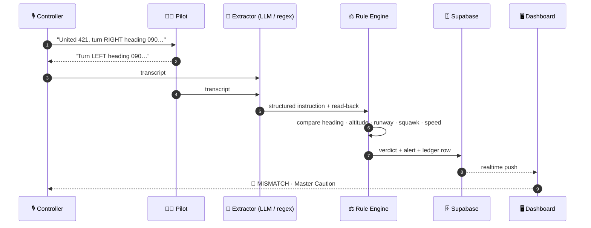
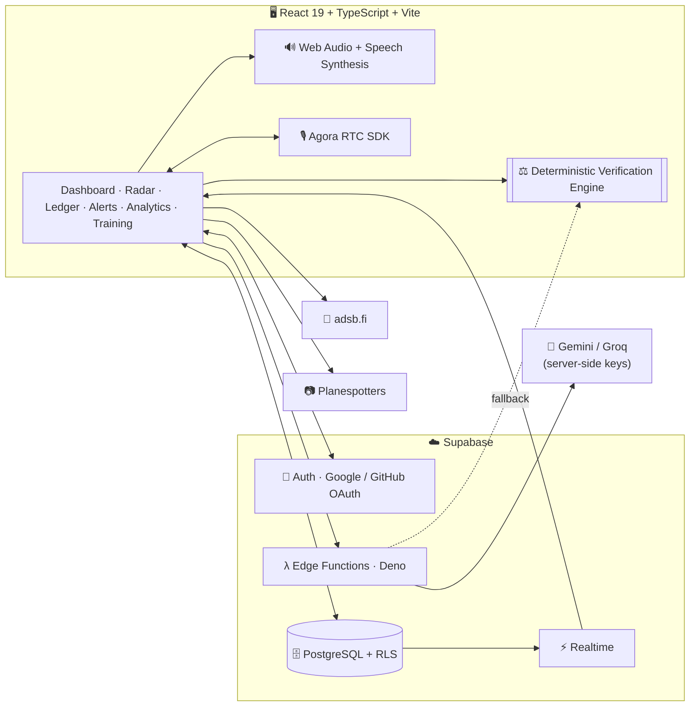
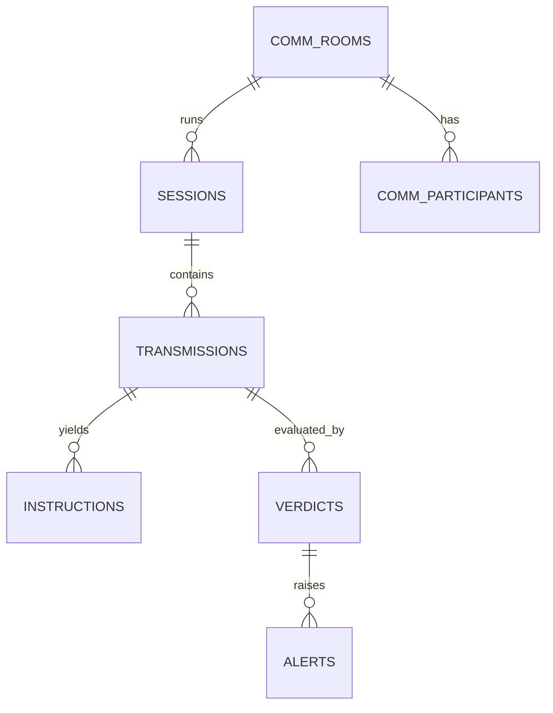

<div align="center">


<br/>

[](#-prototype-notice)
[](https://react.dev)
[](https://www.typescriptlang.org)
[](https://supabase.com)
[](#-testing)

**An AI-assisted safety net for the most important sentence in aviation: the read-back.**
SafeComm listens to controller ↔ pilot radio exchanges, extracts every instruction, and lets a **deterministic rule engine** decide whether the read-back matches.

[**Live demo**](#-live-demo) · [**Pipeline**](#-how-it-works) · [**Screenshots**](#-screenshots) · [**Quick start**](#-quick-start) · [**Roadmap**](#-roadmap)

</div>


## 🚨 Prototype Notice

> **SafeComm is a demonstration, research and phraseology-training prototype. It is NOT certified for operational air traffic control, separation assurance or flight operations, and must never be used to make real-world safety decisions.**


## 🎯 Why SafeComm?

A clearance is only safe once it has been **heard, repeated and confirmed correctly**. Wrong turn direction, a swapped runway, a missing squawk: small slips in a read-back are how level busts and runway incursions begin, and reviewing recordings by hand is slow.

SafeComm explores a hybrid approach:

| | Role | Why |
| :-- | :-- | :-- |
| 🧠 **AI** | *Extracts* structured instructions from transcripts | Natural language is messy; LLMs are good at parsing it |
| ⚖️ **Rules** | *Decide* whether the read-back matches | Safety verdicts must be repeatable, explainable and auditable |
| 📡 **Live data** | *Contextualises* with real ADS-B traffic | Real traffic makes training and review more realistic |

> **Key principle: AI assists with extraction. Deterministic TypeScript rules make the verdict.**


## 🎬 Live Demo

<div align="center">

</div>

The loop above replays the built-in **Heading Direction Swap** scenario: the controller assigns a **right** turn, the pilot reads back **left**, and the engine raises a **critical** alert with a Master Caution earcon.


## ⚙️ How It Works

<div align="center">

</div>



### What the engine checks

| Parameter | Checks | Example failure | Severity |
| :-- | :-- | :-- | :--: |
| **Heading + turn direction** | value and RIGHT/LEFT | RIGHT 090 → read back LEFT 090 | 🔴 Critical |
| **Altitude / flight level** | assigned vs. read-back | 2,000 ft → 3,000 ft | 🔴 Critical |
| **Runway + hold-short** | designator and L/R/C | 28L → 28R | 🔴 Critical |
| **Squawk** | 4-digit code | 4215 omitted | 🟠 Warning |
| **Speed** | assigned speed | 210 → 220 kts | 🟠 Warning |
| **Callsign** | consistency | wrong or missing callsign | 🟠 Warning |

Verdict chips: 🟢 **MATCH** · 🔴 **MISMATCH** · 🟠 **PARTIAL** · ⚪ **UNVERIFIED**


## 📸 Screenshots

### Landing

<table>
<tr>
<td width="50%"></td>
<td width="50%"></td>
</tr>
</table>

### Operations Dashboard


<sub>Scenario player, live radio transcript and ASR feed, read-back compliance, active safety alerts and the deterministic phraseology comparison panel.</sub>

### Safety Alerts and Audit Ledger

<table>
<tr>
<td width="50%"><br/><sub><b>Alerts:</b> severity-graded, acknowledgeable, persisted in Supabase.</sub></td>
<td width="50%"><br/><sub><b>Ledger:</b> searchable audit trail with side-by-side instruction vs. read-back and CSV export.</sub></td>
</tr>
</table>

### Terminal Radar Scope


<sub>10 NM CRT-style scope over KSFO with live ADS-B targets from <a href="https://adsb.fi">adsb.fi</a>, label decluttering, and an Aircraft Target Inspector with registry-matched photos from Planespotters.</sub>

### Analytics and Training

<table>
<tr>
<td width="50%"><br/><sub><b>Analytics:</b> error-rate trend and outcome distribution computed from Supabase.</sub></td>
<td width="50%"><br/><sub><b>Pilot Mode:</b> hear a clearance, type your read-back, get graded instantly.</sub></td>
</tr>
</table>


## 📊 Analytics at a Glance

<div align="center">

</div>


## ✨ Features

| Route | Feature | Highlights |
| :-- | :-- | :-- |
| `/dashboard` | **Live radio dashboard** | Scripted scenarios, live transcript feed, instant verdict chips, training corrections |
| `/map` | **Terminal radar scope** | 10/25/40/60 NM ranges, live ADS-B, runway alignments, decluttered labels, target inspector (altitude, speed, track, vertical rate, hex, registration, squawk) |
| `/comm/:roomId` | **Voice communication rooms** | Two-station ATC ↔ Pilot rooms over Agora RTC, push-to-talk, live transcription and inline verdicts, session rating |
| `/ledger` | **Verification ledger** | Flight-strip style audit trail, filters, highlighted discrepancies, CSV export |
| `/alerts` | **Safety alert center** | Critical / warning / low grading, Web Audio Master Caution earcon, acknowledgement workflow |
| `/analytics` | **Trend intelligence** | Compliance rate, error-rate trend, outcome donut |
| `/training` | **Phraseology simulator** | 10+ FAA/ICAO clearances, instant deterministic grading, streak tracking |
| `/settings` | **Settings** | Light/dark theme, alert sounds, AI parser status, voice cadence, **Reset Demo Data** (user-scoped) |


## 🧭 What Is Real vs. Simulated

| Component | Nature | Notes |
| :-- | :--: | :-- |
| Surveillance radar | 🟢 **Real** | Live positions from `adsb.fi`; photos from Planespotters.net |
| Read-back verification | 🟢 **Real** | Deterministic rule engine (FAA Order 7110.65 / ICAO Annex 10 phraseology) |
| Auth and persistence | 🟢 **Real** | Supabase Auth, PostgreSQL with RLS, realtime subscriptions |
| Two-user voice | 🟢 **Real** | WebRTC audio via Agora RTC |
| Instruction extraction | 🟡 **Hybrid** | Cloud LLM via Edge Function with local regex fallback |
| Dashboard scenarios | 🔵 **Simulated** | Pre-scripted exchanges for demos and training |
| Radio voices | 🔵 **Synthesized** | Web Speech API with simulated squelch |


## 🏗️ Architecture



<details>
<summary><b>🗄️ Database model</b></summary>



Access is controlled by Row Level Security and hardened RPCs; secrets never reach the browser.

</details>


## 🧰 Tech Stack

<div align="center">


</div>

- **Frontend:** React 19, TypeScript (strict), Vite, React Router 7, Lucide icons, Recharts, HTML5 Canvas radar
- **Design system:** bespoke aerospace tokens with a pure black-and-white day mode and a low-glare night mode
- **Backend:** Supabase Auth, PostgreSQL with RLS, Realtime, Deno Edge Functions
- **AI:** Gemini and Groq (Llama 3.3 70B) extraction behind Edge Functions, with a sub-5 ms local regex fallback
- **Voice:** Agora RTC (WebRTC), Web Speech API, procedural Web Audio earcons
- **Data:** adsb.fi (surveillance), Planespotters.net (aircraft photos)


## 🚀 Quick Start

**Prerequisites:** Node.js 18+ (20+ recommended), npm 9+, optionally the Supabase CLI.

```bash
# 1. Clone and install
git clone https://github.com/your-username/SafeComm.git
cd SafeComm
npm install

# 2. Configure the client
cp .env.example .env
```

```ini
# .env: client-side values only (Supabase Dashboard → Project Settings → API)
VITE_SUPABASE_URL=https://your-project-id.supabase.co
VITE_SUPABASE_ANON_KEY=your-anon-public-key
```

```bash
# 3. Run
npm run dev        # → http://localhost:5173
```

<details>
<summary><b>🗄️ Database migrations (run in order in the Supabase SQL Editor)</b></summary>

| # | File | Purpose |
| :-: | :-- | :-- |
| 1 | `001_initial_schema.sql` | Sessions, transmissions, instructions, verdicts, alerts |
| 2 | `002_fix_rls_and_permissions.sql` | Row Level Security policies |
| 3 | `003_comm_rooms.sql` | Two-user communication rooms |
| 4 | `004_secure_comm_rooms.sql` | Hardened room lifecycle RPCs |
| 5 | `005_comm_session_feedback.sql` | Session feedback and ratings |
| 6 | `006_fix_comm_rls_recursion.sql` | Non-recursive participant checks |
| 7 | `007_secure_multiuser_comm_verdicts.sql` | Multi-station verdict sync |
| 8 | `008_comm_ledger_and_radar_rpcs.sql` | Ledger and scope RPCs |
| 9 | `009_alerts_rpc_and_acknowledgement.sql` | Alert management RPCs |
| 10 | `010_analytics_rpc.sql` | Analytics aggregation |
| 11 | `011_reset_demo_data.sql` | Safe demo reset |

</details>

<details>
<summary><b>🔐 Server-side secrets (Edge Functions)</b></summary>

AI provider keys and Agora signing credentials must **never** be placed in `.env` or shipped to the browser. Store them as Supabase secrets and deploy the Edge Functions:

```bash
supabase secrets set GEMINI_API_KEY=... GROQ_API_KEY=... \
                     AGORA_APP_ID=... AGORA_APP_CERTIFICATE=...
supabase functions deploy
```

> Match the secret names to those read by your functions in `supabase/functions/`.

</details>


## 🧪 Testing

```bash
npm run test    # Vitest: verification, audio, ADS-B, photo enrichment, room authorization
npm run lint    # Oxlint
npm run build   # TypeScript compile + production bundle
```

The latest reported run: **227 tests across 12 files**, clean production build. Passing tests demonstrate software behaviour, not aviation safety.


## 🗺️ Roadmap

- [x] Deterministic verification engine (heading, altitude, runway, squawk, speed, callsign)
- [x] Live ADS-B radar scope with aircraft inspector
- [x] Alerts, ledger, analytics and training simulator
- [x] Supabase auth, RLS and realtime
- [ ] Security audit of RPCs, RLS and Reset Demo Data
- [ ] Verified multi-browser, multi-user voice testing
- [ ] Source labels and data-freshness indicators for every aircraft position
- [ ] Expanded edge-case, authorization and multi-user test coverage
- [ ] Accessibility and responsive-layout review
- [ ] Bundle-size optimisation and lint-warning cleanup
- [ ] Public deployment (Vercel or similar) and end-to-end smoke test

## ⚠️ Limitations

- Not certified for operational use; scenarios and voices are simulated.
- LLM extraction can be wrong or incomplete; the rule engine only checks the fields it implements.
- A radar view does not by itself prove live tracking is operational; check data freshness.
- Analytics reflect stored demo data and are **not** validated real-world safety metrics.
- Destructive operations and multi-user access rely on server-side authorization that should be audited before any sensitive use.


## 🎨 Brand

<div align="center">

</div>

## 🙏 Acknowledgements and License

- Aeronautical surveillance data: [adsb.fi](https://adsb.fi)
- Aircraft photography: [Planespotters.net](https://www.planespotters.net) and its contributors, under their published terms
- Phraseology references: FAA Order JO 7110.65 and ICAO Annex 10

SafeComm is developed for research, education and aviation safety demonstration. Add a `LICENSE` file to state your terms.

<div align="center">

<br/>

**Every read-back. Verified.**

<sub>Built with ✈️ for safer skies.</sub>

</div>
